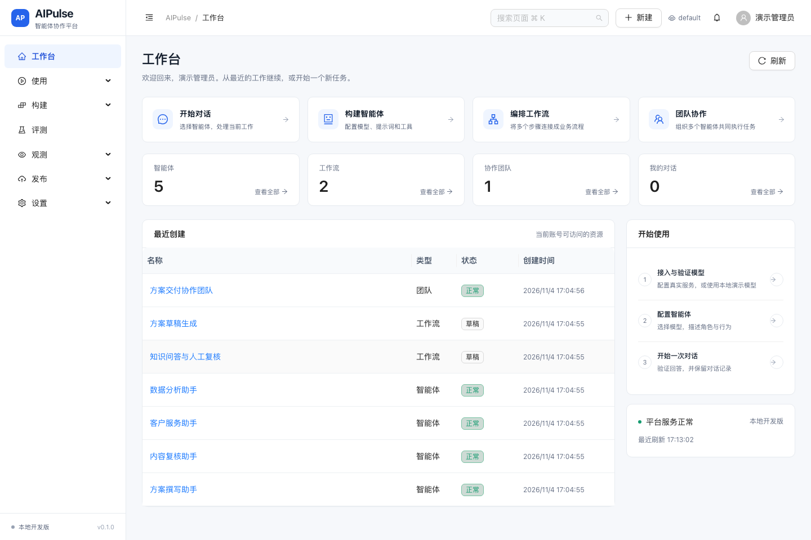
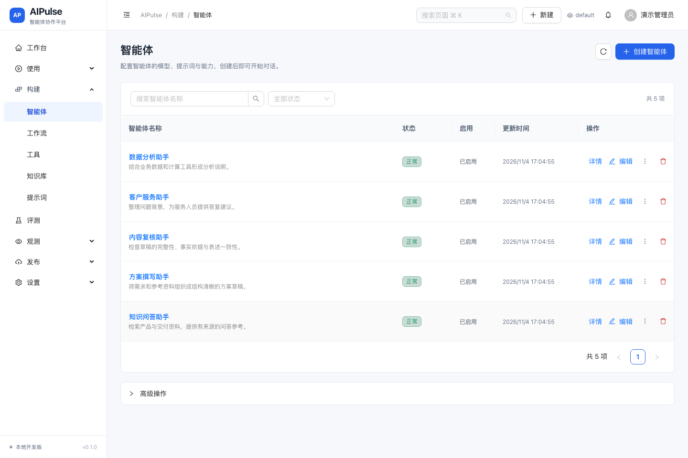
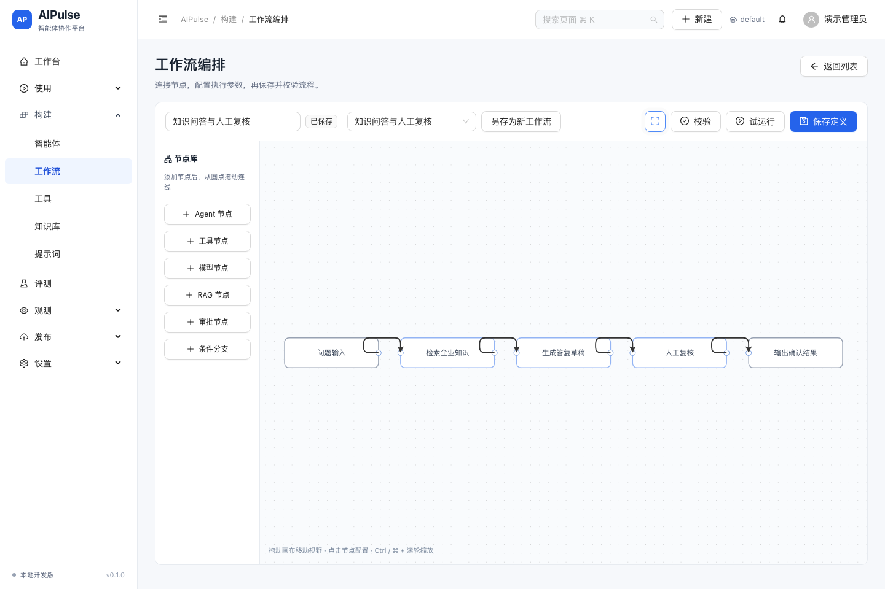
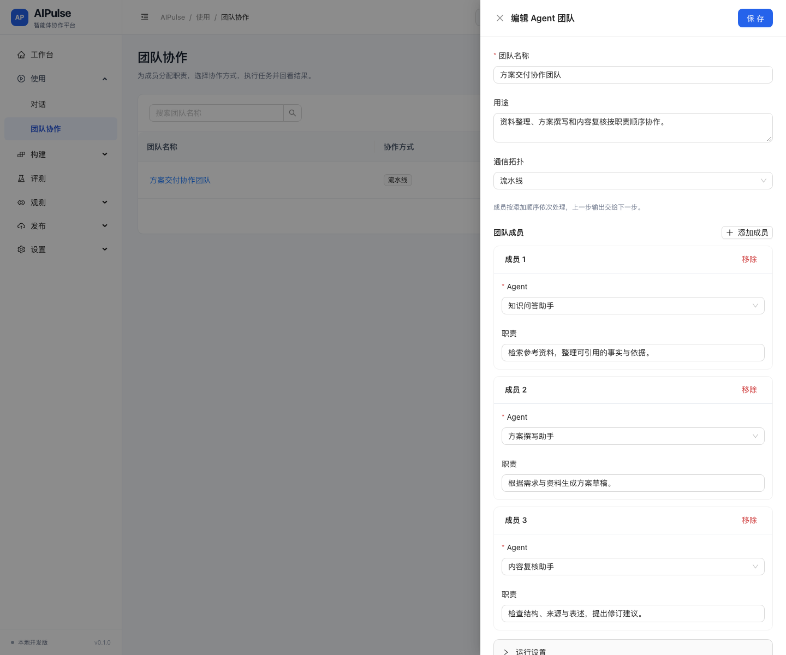
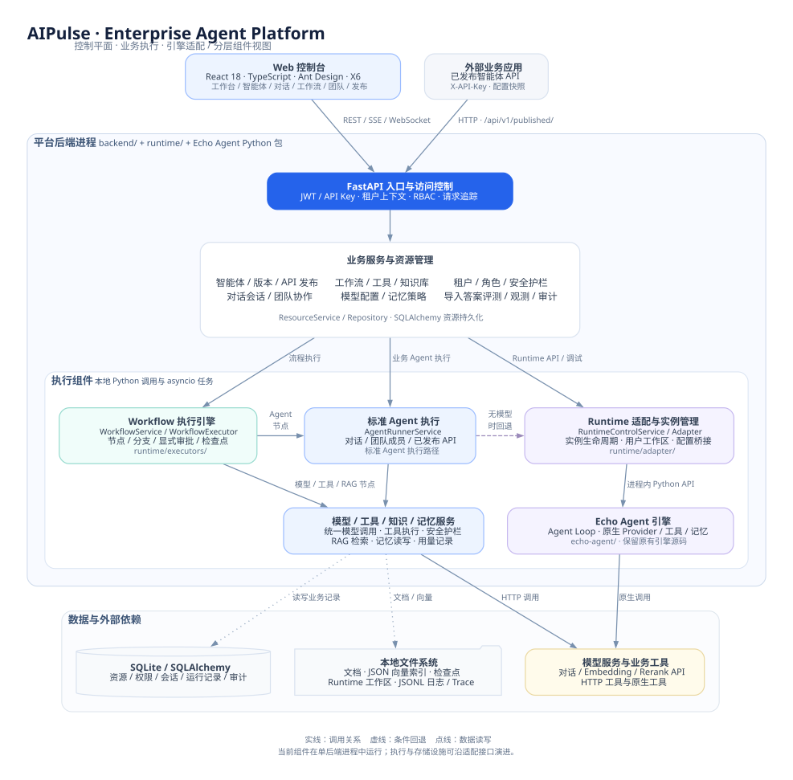

<p align="center">
  
</p>

<h1 align="center">AIPulse</h1>

<p align="center">
  <strong>Enterprise Agent Platform · 企业智能体构建、协作与治理平台</strong>
</p>

<p align="center">
  让智能体成为可管理的业务能力。<br>
  Build Agents. Connect Knowledge. Orchestrate Work.
</p>

<p align="center">
  
  
  
  
</p>

<p align="center">
  <a href="#为什么选择-aipulse">为什么选择 AIPulse</a> ·
  <a href="#核心能力">核心能力</a> ·
  <a href="#界面预览">界面预览</a> ·
  <a href="#技术架构">技术架构</a> ·
  <a href="#快速开始">快速开始</a> ·
  <a href="#开发与验证">开发与验证</a> ·
  <a href="#文档导航">文档导航</a>
</p>

**AIPulse 是面向企业的智能体应用构建与协同运行平台。** 它将模型、工具、知识与智能体组织到统一工作空间，连接 **构建、编排、协作、发布与治理**，帮助团队把 AI 能力接入实际业务。

以 **Agent** 封装可复用的专业能力，以 **Workflow** 沉淀明确的业务流程，以 **Team** 组织多角色协作。业务人员使用智能体完成工作，开发者组合能力构建应用，管理员通过权限、策略和运行记录管理平台。



## 为什么选择 AIPulse

### 统一能力资产，支撑应用复用

在同一平台维护模型、提示词、工具、知识库和智能体配置。团队可以复用已有资源构建新的业务应用，并通过版本和发布快照管理应用配置。

### 从单个助手，走向流程与团队

对话、工作流和多智能体团队共享同一套能力基础。知识问答可以使用单个 Agent；需要明确步骤与人工复核的任务可以使用 Workflow；需要不同职责协作的任务可以组织为 Team。

### 让治理进入执行过程

将租户与角色权限、工具审批、输入输出护栏、API 凭证和操作审计纳入应用运行路径。让业务使用、应用开发与平台管理在清晰的职责边界内协同。

### 连接交互体验与业务集成

通过可视化控制台配置和验证应用，再通过已发布 API 对接业务系统；结合会话、运行记录、用量与日志回看执行情况，为后续优化提供依据。

## 核心能力

| 能力 | 在 AIPulse 中完成的工作 |
| --- | --- |
| 智能体构建 | 通过分步向导配置模型、提示词、工具、知识库、记忆和护栏，创建后继续编辑与调试。 |
| 对话工作空间 | 管理会话、回看历史、重新生成、复制回答与提交反馈，支持 Markdown 表格和代码展示。 |
| 知识库与 RAG | 上传文档、解析分块、建立向量索引，执行向量与关键词混合检索、重排序和检索测试。 |
| 可视化工作流 | 在画布中连接 Agent、模型、工具、RAG、条件分支与人工审批节点，保存、校验、试运行并查看节点结果。 |
| 多智能体协作 | 配置成员与职责，选择流水线、协调者或全连接协作方式，执行任务并回看运行历史。 |
| 版本与 API 发布 | 保存配置版本、记录发布与回滚；将 Agent 配置快照发布为 API，管理凭证权限、有效期、停用与轮换。 |
| 权限与安全治理 | 管理租户、用户和角色权限，执行工具审批、输入输出护栏、敏感凭证脱敏与审计链校验。 |
| 评测与运行观测 | 管理数据集，对导入的实际答案进行评分；查询运行记录、用量、成本、日志、Trace 和告警。 |

## 典型应用场景

| 场景 | 业务价值 | 能力组合 |
| --- | --- | --- |
| 企业知识服务 | 将分散的产品、制度和交付资料组织成可检索的问答入口。 | 知识库 + RAG + Agent 对话 |
| 方案与内容协作 | 按资料整理、草稿撰写、内容复核等职责组织协作。 | 多角色 Agent + Team + 运行历史 |
| 业务流程辅助 | 将检索、模型生成、工具调用和人工复核连接为明确步骤。 | Workflow + 工具 + 显式审批 |
| AI 能力服务化 | 将已验证的智能体配置发布给业务应用调用，管理凭证和访问范围。 | 版本快照 + API 发布 + 凭证管理 |

从接入模型与知识，到定义智能体，再到编排协作、发布调用和回看运行，AIPulse 提供统一的应用构建路径。上述场景由平台能力组合实现，具体流程与业务规则由使用方配置。

## 界面预览

以下截图来自当前源码运行的本地隔离环境，资源名称与内容均为演示数据。

<details>
<summary><strong>智能体管理：统一列表、资源状态与创建入口</strong></summary>



</details>

<details>
<summary><strong>工作流编排：知识检索、答复生成与人工复核</strong></summary>



</details>

<details>
<summary><strong>团队配置：协作方式、成员分工与职责定义</strong></summary>



</details>

## 技术架构

AIPulse 以 **控制平面、业务执行与引擎适配**分层组织平台能力：上层统一管理资源、策略和应用入口；业务执行层组合模型、知识、工具与记忆；Runtime Adapter 连接 Echo Agent 原生引擎，保留清晰的扩展边界。

架构围绕三项原则展开：**能力复用、治理贯穿、执行解耦**。不同应用形态共享资源与业务服务，工作流和团队复用 Agent 能力，引擎接入由适配层承接。



[查看 PNG](docs/assets/aipulse-architecture.png) · [Graphviz 可编辑源文件](docs/assets/aipulse-architecture.dot) · [架构与执行链路说明](docs/architecture.md)

<details>
<summary><strong>查看三类执行路径与当前部署边界</strong></summary>

三类执行入口在源码中各有职责：

| 执行路径 | 入口与实现 |
| --- | --- |
| 业务 Agent | 对话、团队成员及已发布 API 调用 `AgentRunnerService`，组合模型调用、工具、知识检索、记忆与护栏服务。 |
| 工作流 | `WorkflowService` 驱动 `WorkflowExecutor` 执行节点，保存检查点并处理显式审批；Agent 节点复用标准 Agent 执行路径。 |
| 原生 Runtime | Runtime API 与调试通过 `RuntimeControlService → EchoAgentRuntimeAdapter` 管理 Echo Agent 实例；标准 Agent 在没有可用模型配置时可回退到此路径。 |

当前源码版通过进程内 Python 调用和 `asyncio` 任务运行上述组件，使用单个后端进程。资源配置、权限、消息、运行与审计记录保存在 SQLite；文档、JSON 向量索引、工作流检查点、Runtime 工作区以及 JSONL 日志和 Trace 保存在本地文件系统。Echo Agent 引擎通过适配层接入，平台功能位于引擎源码之外。

</details>

### 技术栈

| 层次 | 当前实现 |
| --- | --- |
| 前端 | React 18、TypeScript 5、Ant Design 5、React Router 7、AntV X6、Webpack 5 |
| 后端 | Python 3.11+、FastAPI、Pydantic 2、SQLAlchemy 2、Alembic、HTTPX |
| 执行 | AgentRunnerService、WorkflowExecutor、EchoAgentRuntimeAdapter、`asyncio` |
| 存储 | SQLite、本地文件、JSON 向量索引、JSONL 日志与 Trace |
| 验证 | pytest、Ruff、mypy、Vitest、Playwright、TypeScript 类型检查 |

## 快速开始

### 环境要求

- **Python 3.11+**，可创建虚拟环境。
- **Node.js 20.19+（20.x）或 22.12+**，以及 npm。
- Git，以及可用于安装 Python / npm 依赖的网络环境。

以下命令使用 macOS / Linux 的 Bash。默认使用 SQLite，无需先安装独立数据库或消息队列。

### 1. 获取源码并安装后端

在终端中执行：

```bash
git clone https://github.com/fuyuxiang/aipulse-platform.git
cd aipulse-platform

python3 -m venv .venv
source .venv/bin/activate
python -m pip install -e ./echo-agent -e ./backend

mkdir -p data/sqlite
cd backend
python -m alembic upgrade head
python ../scripts/init_db.py
python -m uvicorn app.main:app --reload --host 127.0.0.1 --port 8000
```

`init_db.py` 会初始化默认租户、管理员、角色权限及本地演示模型，无需重复执行 `init_admin.py`。

### 2. 启动前端

另开终端，从仓库根目录执行：

```bash
cd frontend
npm ci
npm run dev
```

| 入口 | 地址 |
| --- | --- |
| AIPulse 控制台 | [http://127.0.0.1:3000](http://127.0.0.1:3000) |
| 交互式 API 文档 | [http://127.0.0.1:8000/docs](http://127.0.0.1:8000/docs) |
| OpenAPI JSON | [http://127.0.0.1:8000/api/v1/openapi.json](http://127.0.0.1:8000/api/v1/openapi.json) |
| 服务健康检查 | [http://127.0.0.1:8000/health](http://127.0.0.1:8000/health) |

前端开发服务器将 `/api`、`/health` 及对应 WebSocket 请求代理到后端的 `8000` 端口。

### 3. 登录与配置第一个智能体

| 配置项 | 默认值 |
| --- | --- |
| 租户 | `default` |
| 用户名 | `admin` |
| 密码 | `admin123456` |

默认账号及开发密钥仅用于本地环境，首次登录后修改默认密码。

1. **接入模型**：进入「设置 → 模型」，填写模型标识、服务地址与认证方式，并执行连接验证。默认 `Local` / `Echo Agent Native` 模型用于流程演示；真实生成需要配置实际模型服务。
2. **创建智能体**：进入「构建 → 智能体」，通过向导选择生成式模型、填写提示词，按需绑定工具、知识库和安全策略。
3. **开始对话**：进入「使用 → 对话」，选择已保存的智能体并创建会话，验证回答与历史记录。
4. **编排业务流程**：在「构建 → 工作流」连接节点、配置资源并校验试运行；需要成员分工时，在「使用 → 团队协作」建立团队。
5. **对外提供能力**：在「发布 → 版本发布」管理版本，在「API 发布与凭证」选择版本或当前草稿快照，生成调用凭证。

需要企业知识问答时，先在「构建 → 知识库」选择向量模型及对应维度，上传文档并验证检索，再将知识库绑定到智能体。详见[用户手册](docs/user-guide.md)。

### 4. 调用已发布 API

在控制台创建 API 发布后，保存创建时返回的完整密钥。普通详情查询只展示凭证元数据；需要新密钥时执行轮换。

```bash
export AIPULSE_AGENT_ID="替换为已发布的智能体 ID"
export AIPULSE_API_KEY="替换为创建或轮换时显示的密钥"

curl --fail-with-body http://127.0.0.1:8000/api/v1/published/"${AIPULSE_AGENT_ID}"/chat \
  -H "Content-Type: application/json" \
  -H "X-API-Key: ${AIPULSE_API_KEY}" \
  -d '{"message":"请概括交付流程，并说明资料来源。","session_id":"example-session"}'
```

接口会校验发布状态、凭证权限和有效期。完整接口定义见运行中的 API 文档及[接口说明](docs/api.md)。

### 配置与本地数据

后端读取 `AIPULSE_` 前缀环境变量；按上述启动方式，也可在 `backend/.env` 中配置。模型密钥可使用模型表单中的环境变量认证方式，避免写入仓库。配置定义见 [config.py](backend/app/core/config.py)。

| 环境变量 | 默认值 / 用途 |
| --- | --- |
| `AIPULSE_DATABASE_URL` | `sqlite:///data/sqlite/aipulse.db`，相对路径基于仓库根目录解析。 |
| `AIPULSE_ECHO_AGENT_PATH` | `echo-agent`，本仓库内的引擎源码目录。 |
| `AIPULSE_DATA_DIR` | `data`，运行数据根目录；文件、向量、日志与 Trace 另有独立路径设置。 |
| `AIPULSE_JWT_SECRET` | 本地开发默认值；非本地环境需配置独立密钥。 |
| `AIPULSE_PASSWORD_SALT` | 本地开发默认值；应在初始化用户前确定，后续变更会影响已有密码校验。 |
| `AIPULSE_SCHEDULER_ENABLED` | `true`，是否启动本地定时任务轮询。 |

运行后产生的业务数据位于 `data/`，不作为源码提交。数据库、文档、向量索引及检查点应一起纳入备份范围。

## 项目结构

```text
aipulse-platform/
├── frontend/                 # React 控制台
│   ├── src/pages/            # 工作台、使用、构建、评测、观测、发布、设置
│   ├── src/components/       # 布局、资源表单、Markdown 与公共交互
│   ├── src/agent-designer/   # 智能体配置向导
│   ├── src/workflow-designer/ # X6 工作流编排器
│   └── tests/                # 单元测试与浏览器业务回归
├── backend/                  # FastAPI 平台后端
│   ├── app/api/              # REST、SSE 与 WebSocket 接口
│   ├── app/services/         # 构建、运行、协作、评测、观测与设置服务
│   ├── app/models/           # SQLAlchemy 模型
│   ├── app/repositories/     # 数据访问与租户过滤
│   ├── app/db/               # 会话、初始化与默认数据
│   ├── alembic/              # 数据库迁移
│   └── tests/                # 单元、集成与接口契约测试
├── runtime/                  # 本地执行与引擎适配组件
│   ├── adapter/              # 实例生命周期、模型、工具、记忆等桥接
│   ├── executors/            # 工作流、检查点、审批与本地任务执行
│   └── storage/              # 本地文档、向量、日志与 Trace 存储
├── echo-agent/               # 随仓库保留的 Echo Agent 引擎源码
├── scripts/                  # 初始化、启动、检查与真实模型验证
├── docs/                     # 用户手册、架构、运维与验收记录
│   └── assets/               # 架构图源文件、导出图与产品截图
└── data/                     # 运行时生成的本地数据（不入库）
```

## 开发与验证

安装依赖并激活 Python 虚拟环境后，在仓库根目录执行：

```bash
# 后端、Runtime 与前端单元测试
python scripts/run_tests.py

# 前端类型检查与生产构建
npm --prefix frontend run lint
npm --prefix frontend run build

# 首次运行浏览器测试时安装 Chromium
cd frontend
npx playwright install chromium
npm run e2e
```

浏览器测试会启动独立前后端，使用临时 SQLite、文件和向量目录，默认端口为 `3100` / `8107`。也可通过 `PLAYWRIGHT_CHROMIUM_EXECUTABLE_PATH` 指定已有 Chromium。前端生产构建输出至 `frontend/dist/`，部署静态资源时需配置 SPA 路由回退和 API 反向代理。

2026-11-04 的验收记录包含 **45 项后端测试、10 项前端单元测试、12 项浏览器业务测试和 26 个导航入口检查**，并验证了真实模型对话、工具调用、知识检索及团队流水线。测试范围、命令与证据见[验收结果](docs/reviews/aipulse-acceptance-results.md)和[测试说明](docs/testing.md)。

## 项目状态与演进方向

当前源码交付用于本地开发与受控试点，已完成的验证见[验收结果](docs/reviews/aipulse-acceptance-results.md)。平台的后续演进围绕企业协作、持续评测和运行基础设施展开：

| 方向 | 计划建设内容 |
| --- | --- |
| 企业协作治理 | 细化组织与资源 ACL，完善任务、交付物、复核和验收状态机。 |
| 执行连续性 | 补齐 Agent 内部工具审批续跑，扩展复杂工作流恢复与跨进程任务接管。 |
| 持续优化 | 接通自动实际 Agent 评测、模型原生 Token 流式与更完整的运行分析。 |
| 基础设施演进 | 沿现有接口引入外部数据库、对象与向量存储、分布式执行和可观测设施。 |

这些条目为演进方向，具体设计见[生产演进规划](docs/future-production-deployment.md)。

### 当前能力边界

<details>
<summary><strong>查看当前实现范围与验收说明</strong></summary>

- **本地开发交付**：当前使用单进程执行、本地 SQLite 和文件存储；外部数据库、分布式 Worker、消息队列与高可用部署属于后续建设范围。
- **流式与停止**：聊天目前通过 SSE 返回缓冲后的结果，尚非模型原生 Token 流；停止接收不代表撤销已经发出的外部调用。
- **审批恢复**：显式工作流人工审批和工具节点支持审批后继续；Agent 内部工具调用的通用自动续跑尚未完整接通。
- **团队与评测**：团队支持协作执行与历史记录，尚无完整的 Task / Artifact / Review 验收状态机；评测以导入已有答案评分为主。
- **发布隔离**：API 发布固定 Agent 配置快照；引用的模型、工具和知识库仍可变化。渠道与 Widget 配置不等同于完成外部投递验收。
- **治理与恢复**：组织级资源 ACL、复杂工作流及重启接管仍有待完善的场景；详细差距与优先级见[产品与技术评审](docs/reviews/aipulse-product-technical-review.md)。

</details>

## 文档导航

| 文档 | 内容 |
| --- | --- |
| [用户手册](docs/user-guide.md) | 模型、智能体、知识库、工作流、团队与 API 发布操作。 |
| [技术架构](docs/architecture.md) | 当前组件边界、执行路径、存储关系与后续演进。 |
| [前端开发](frontend/README.md) | Node 要求、开发代理、路由、构建与浏览器测试。 |
| [接口说明](docs/api.md) | API 模块与调用约定；精确字段以运行中的 OpenAPI 为准。 |
| [安全设计](docs/security.md) | 鉴权、权限、工具审批与审计设计。 |
| [测试说明](docs/testing.md) | 单元、集成、浏览器及真实模型验证方式。 |
| [本地运维](docs/operations-local.md) | 本地运行、日志、备份与恢复操作。 |
| [产品与技术评审](docs/reviews/aipulse-product-technical-review.md) | 能力核对、整改项及尚待补齐的范围。 |
| [前端验收](docs/reviews/aipulse-frontend-acceptance.md) | 界面改造说明、真实截图及交互验证。 |
| [生产演进规划](docs/future-production-deployment.md) | 外部存储、执行集群和可观测设施的后续方案。 |

## 许可

AIPulse 平台沿用当前仓库的专有授权声明：**Proprietary. All rights reserved.**

Echo Agent 的 MIT 许可声明见其 [pyproject.toml](echo-agent/pyproject.toml)。第三方组件遵循各自的许可约定。
