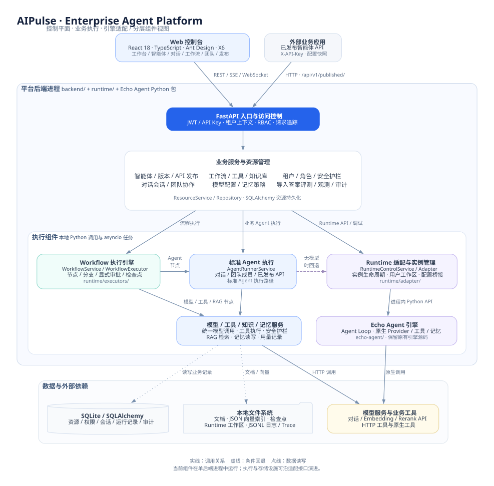

# AIPulse 技术架构

本文对应当前仓库的本地实现。AIPulse 将企业资源治理、业务执行和引擎适配分开组织；后端服务、`runtime/` 组件与 Echo Agent Python 包通过进程内调用协作。图中的边界表达代码职责，不表示已经部署了独立微服务或执行集群。



[PNG 版本](assets/aipulse-architecture.png) · [Graphviz 源文件](assets/aipulse-architecture.dot)

## 组件与源码边界

| 组件 | 责任 | 主要位置 |
| --- | --- | --- |
| Web 控制台 | 工作台、资源管理、智能体向导、对话、工作流画布、团队与发布页面。 | [frontend/src](../frontend/src/) |
| API 与访问控制 | REST、SSE、WebSocket 入口，认证、租户上下文与权限检查。 | [api](../backend/app/api/)、[deps.py](../backend/app/api/deps.py)、[authorization.py](../backend/app/websocket/authorization.py) |
| 资源与业务服务 | 管理租户、角色、Agent、模型、工具、知识、版本、会话、评测和观测记录。 | [services](../backend/app/services/)、[repositories](../backend/app/repositories/) |
| 标准 Agent 执行 | 组合模型、工具、RAG、记忆与护栏，持久化执行状态、用量和结果。 | [agent_runner_service.py](../backend/app/services/runtime/agent_runner_service.py) |
| 工作流执行 | 节点调度、条件分支、显式审批、检查点保存与恢复。 | [workflow_service.py](../backend/app/services/build/workflow_service.py)、[runtime/executors](../runtime/executors/) |
| Runtime 适配 | 原生实例生命周期、用户工作区及模型、工具、记忆等配置桥接。 | [runtime/service.py](../backend/app/runtime/service.py)、[runtime/adapter](../runtime/adapter/) |
| Echo Agent | 原生 Agent Loop、Provider、工具与记忆等引擎实现。 | [echo-agent](../echo-agent/) |
| 数据与文件 | SQLAlchemy 资源访问、本地文档与向量索引、日志、Trace、检查点。 | [db](../backend/app/db/)、[runtime/storage](../runtime/storage/) |

平台功能通过适配层调用现有 Echo Agent 源码。平台业务数据模型和企业权限逻辑位于 `backend/`，不写入 `echo-agent/` 引擎。

## 三类执行路径

### 1. 对话、团队成员和已发布 API

这些入口使用 `AgentRunnerService` 执行业务 Agent：

1. 入口服务检查身份、资源归属、会话或发布凭证，准备已保存的 Agent 配置或发布快照。
2. AgentRunner 执行输入护栏，读取绑定知识库和允许的记忆，构造模型消息。
3. 有模型时，通过 `ModelInvocationService` 请求模型；模型返回工具调用时，由 `ToolService` 校验绑定与审批并执行。
4. 执行输出护栏，保存 Agent 运行记录、用量、成本和允许写入的记忆；入口服务保存自己的会话或团队历史。
5. 没有可用模型配置时，可进入原生 Runtime 调试回退。供应商错误不会被当作真实调用成功。

主要入口实现：

- [chat_service.py](../backend/app/services/runtime/chat_service.py)：用户会话与消息。
- [multi_agent_service.py](../backend/app/services/runtime/multi_agent_service.py)：流水线、协调者和全连接协作。当前团队通信由平台服务组织，不等于已部署跨系统 A2A 网络。
- [published.py](../backend/app/api/v1/published.py)：校验 `X-API-Key`，使用发布的 Agent 配置快照执行。

### 2. 可视化工作流

`WorkflowService` 读取工作流定义，交给 `WorkflowExecutor` 校验和执行。Agent 节点调用标准 AgentRunner；模型、工具和 RAG 节点调用对应平台服务。执行使用本地 `asyncio` 任务，并将检查点保存至本地文件。

显式人工审批或工具节点可以进入等待状态，审批后由恢复接口继续。拒绝、取消或已终结的运行不能直接恢复；安全重试依赖可用检查点。Agent 内部工具调用的通用审批续跑仍需补齐。

工作流事件总线及活动任务注册位于进程内。本地检查点不代表已经具备分布式锁、跨 Worker 接管或任意复杂工作流的完整恢复保证。

### 3. Echo Agent 原生 Runtime

Runtime API 和原生调试经 `RuntimeControlService → EchoAgentRuntimeAdapter` 调用 Echo Agent。适配器负责创建、启动、停止、重启和销毁实例，以及注入模型、工具权限、记忆和资源限制。

工作区路径按租户、Agent 和用户会话摘要组织，接口检查实例归属。这属于实例访问和文件工作区隔离，当前没有为每个 Agent 启动独立进程或容器。

原生 Runtime 与标准 AgentRunner 在桥接和恢复方面仍有差异，不能将引擎包含某项能力直接视为平台已完成对应集成。

## 存储与外部依赖

| 数据 | 当前实现 |
| --- | --- |
| 资源、权限、消息、运行、审计 | SQLAlchemy + SQLite，默认 `data/sqlite/aipulse.db`。 |
| 文档文件 | `LocalObjectStore`，默认 `data/files/`。 |
| 向量索引 | `LocalVectorStore`，默认 `data/vector/`；JSON 文件，余弦相似度与关键词混合检索。当前不是 FAISS 或 Milvus。 |
| 工作流检查点 | `data/checkpoints/` 下的本地文件。 |
| 原生 Runtime 工作区 | `data/runtime/` 下按用户会话隔离的目录。 |
| 日志与请求 Trace | 本地 JSONL，默认 `data/logs/`、`data/traces/`。 |
| 模型与业务接口 | 由已配置的 Provider / 模型和 HTTP 工具调用外部服务。 |

知识库通过模型服务生成 Embedding，并可调用 Rerank；文档向量与查询向量需要使用一致的向量空间。模型或维度变化后应完整重建索引。初始化的 Local Provider 只用于流程演示。

API 发布保存 Agent 配置快照，但引用的模型、工具和知识库仍可变更。快照固定并不代表所有外部依赖已经不可变。

## 权限与可观测性

控制台根据 `/auth/me` 返回的权限展示入口；服务端负责实际校验。用户访问使用 JWT，已发布 Agent 使用独立 API Key。写操作通过资源服务记录审计链，凭证在接口输出和审计中脱敏。工具审批与申请人、工具、参数和有效期绑定。

可观测功能使用业务运行记录、模型调用记录、结构化日志和本地 Trace 文件。当前仓库没有交付完整的 Prometheus、Grafana、ELK 或 Jaeger 部署。

组织级资源 ACL、完整 Task / Artifact / Review 状态机、原生 Token 流式和自动实际 Agent 评测等差距，见[产品与技术评审](reviews/aipulse-product-technical-review.md)与[验收结果](reviews/aipulse-acceptance-results.md)。

## 架构图维护

架构图使用 Graphviz 绘制，SVG 供 README 引用，PNG 供预览和导出。修改 `.dot` 源文件后，在仓库根目录使用已安装的 Graphviz 重新生成：

```bash
dot -Tsvg docs/assets/aipulse-architecture.dot -o docs/assets/aipulse-architecture.svg
dot -Tpng -Gdpi=144 docs/assets/aipulse-architecture.dot -o docs/assets/aipulse-architecture.png
```

图中使用 `PingFang SC` 字体。其他系统生成图片时可将源文件中的字体替换为已安装的中文字体，例如 `Noto Sans CJK SC`。

后续演进可以沿数据访问、存储和执行器边界替换外部数据库、对象存储、向量数据库与分布式任务组件；这些是替换点，不是当前部署依赖。规划见[生产演进方案](future-production-deployment.md)。
